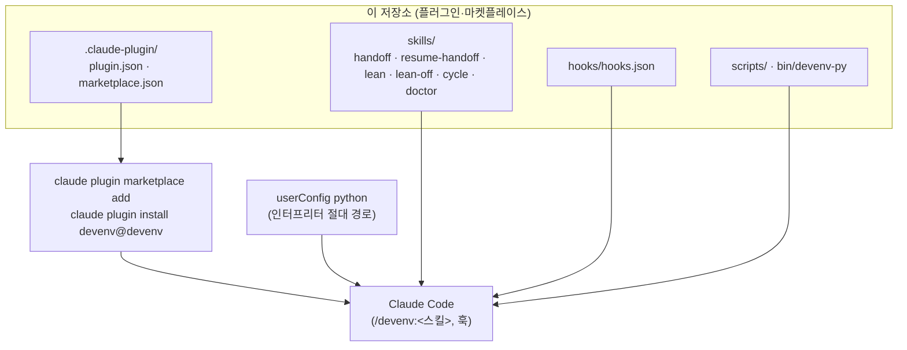
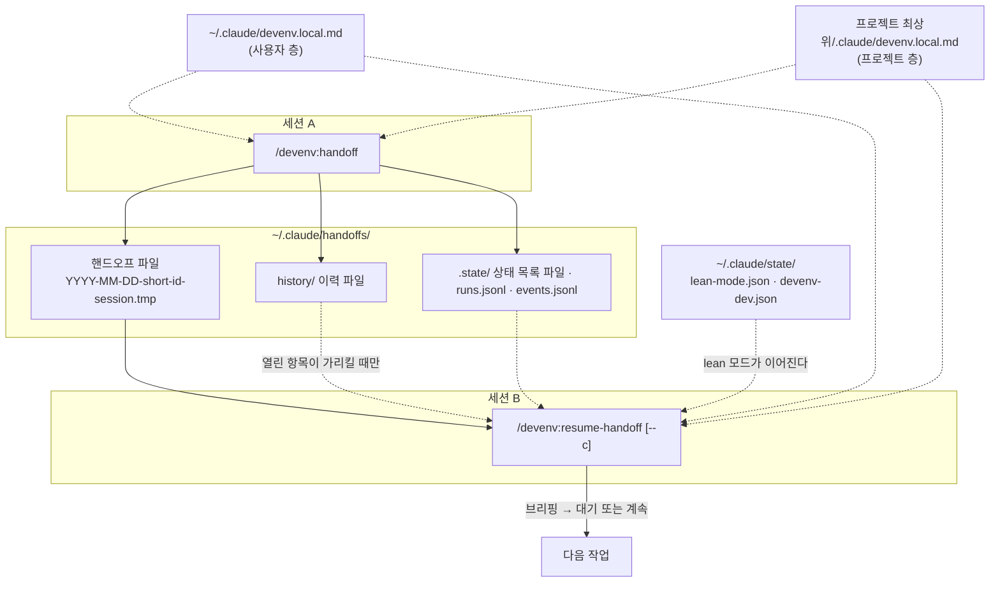
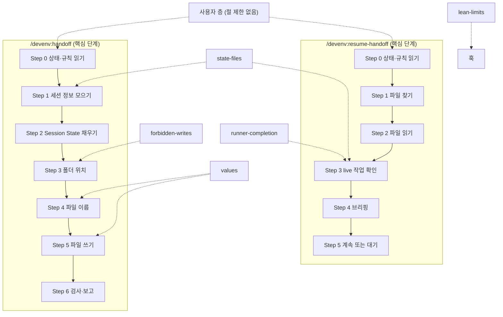

# devenv

[English](README.md) | 한국어

devenv는 Claude Code 플러그인이다. 한 세션이 알던 것을 다음 세션에 넘기고, lean 모드로 메인 세션의 컨텍스트를 작게 유지한다. 이 README는 devenv를 쓰는 사람이 따라갈 순서를 소유한다.

```sh
claude plugin marketplace add ai-dev-methodologies/devenv
claude plugin install devenv@devenv --scope user --config python=/path/to/python3
```

`/path/to/python3`에는 Python 3.10 이상 인터프리터의 절대 경로를 넣는다. 설치한 뒤 새 세션에서 `/devenv:doctor`를 실행한다. 마지막 줄이 `fail=0`이어야 한다. 요구 사항과 다른 명령은 [설치](#설치)에 있다.

이 README는 무엇인지, 어떻게 설치하고 쓰고 점검하는지를 다룬다. 이 문서가 소유하는 사실은 다음 7가지다.

- devenv가 무엇인지와 전체 구조
- 설치·갱신·제거 방법
- 스킬과 훅이 하는 일, 훅이 막지 못하는 것
- 맥락 이월 원칙과 이력 파일의 위치
- 규칙 층(사용자 층과 프로젝트 층)
- 개발자 모드, 실행 기록, doctor 출력 읽는 법
- 옛 단독 handoff 설치본에서 옮기는 방법

핸드오프 파일의 양식과 단계별 절차는 `skills/handoff/SKILL.md`와 `skills/resume-handoff/SKILL.md`가 소유한다.

목차: [devenv란](#devenv란) · [설치](#설치) · [스킬](#스킬) · [훅이 강제하는 것](#훅이-강제하는-것) · [lean 모드 끄기](#lean-모드-끄기) · [규칙 층](#규칙-층) · [개발자 모드와 실행 기록](#개발자-모드와-실행-기록) · [doctor 출력 읽는 법](#doctor-출력-읽는-법) · [옛 단독 설치본에서 옮기기](#옛-단독-설치본에서-옮기기) · [한계](#한계) · [라이선스](#라이선스)

변경 기록은 [CHANGELOG.md](CHANGELOG.md)에 있다. devenv가 왜 이렇게 동작하는지는 [docs/article.ko.md](docs/article.ko.md)가 설명한다.

## devenv란
devenv는 스킬 6개와 훅 등록 5개를 담은 Claude Code 플러그인이다. 하는 일은 다음 3가지다.

- 한 세션이 알던 것을 다음 세션에 넘긴다(`handoff`·`resume-handoff`).
- 훅이 강제하는 lean 모드로 메인 세션의 컨텍스트를 작게 유지한다.
- 계획·검토·실행·검증의 기본 사이클을 돌리고, 자기 설치를 점검한다(`doctor`).

모든 훅과 스킬이 부르는 스크립트는 설치 때 지정한 Python 인터프리터로 실행한다.

### 한눈에 보기
#### 설치


#### 실행(세션 A에서 세션 B로)


실선은 설치·실행·쓰기·재개의 주 흐름이다. 점선은 필요할 때 읽는 참조다.

### 구성 요소
| 경로 | 하는 일 |
|---|---|
| `.claude-plugin/plugin.json` | 플러그인 매니페스트다. 이름 `devenv`, 버전, 라이선스, 필수 userConfig 항목 `python`을 담는다 |
| `.claude-plugin/marketplace.json` | 저장소 최상위의 플러그인 1개를 담은 마켓플레이스 `devenv`다. 설치 id는 `devenv@devenv`다 |
| `skills/handoff/SKILL.md` | `/devenv:handoff` 스킬이다. 핸드오프 파일의 양식과 쓰는 단계를 정한다 |
| `skills/resume-handoff/SKILL.md` | `/devenv:resume-handoff` 스킬이다. 핸드오프 파일을 고르고 읽고 브리핑하는 단계를 정한다 |
| `skills/lean/SKILL.md` · `skills/lean-off/SKILL.md` | lean 모드를 켜고, 상태를 읽고, 끈다. 끄기 스킬은 사용자가 입력한다 |
| `skills/cycle/SKILL.md` | 기본 작업 사이클과 덮어쓰기 지점 14개다 |
| `skills/doctor/SKILL.md` | `scripts/doctor.py`를 실행한다. 설치 점검, 개발자 모드, 프로젝트 규칙 파일 생성을 맡는다 |
| `hooks/hooks.json` | 훅 5개를 `${user_config.python}` 명령으로 등록한다 |
| `bin/devenv-py` | `--py` 뒤에 준 인터프리터로 플러그인 스크립트를 실행한다. 스킬은 이 래퍼로 스크립트를 부른다 |
| `scripts/handoff_state.py` | 두 핸드오프 스킬의 Step 0에서 한 번 실행한다. git 상태, 규칙 파일 경로, 상태 목록 파일 경로를 낸다. `--resume`은 고른 핸드오프, `continue:` 줄, 서브에이전트 상태, 검사 결과도 낸다 |
| `scripts/check_handoff.py` | 핸드오프 파일이 양식을 지켰는지 검사한다. `/devenv:handoff` Step 6과 `handoff_state.py`가 부른다 |
| `scripts/run_log.py` · `scripts/run_report.py` | 핸드오프 스크립트 실행마다 `runs.jsonl`에 1줄을 쓰고(개발자 모드), 그 기록을 읽기 전용으로 요약한다 |
| `scripts/devenv_state.py` | lean 모드와 개발자 모드 상태 파일을 쓰는 유일한 도구다 |
| `scripts/rules_layer.py` | 규칙 층을 읽고 프로젝트 규칙 파일을 만든다 |
| `scripts/hook_read.py` · `scripts/hook_bash.py` · `scripts/hook_return.py` · `scripts/hook_session_start.py` | 훅이다(「훅이 강제하는 것」 참고) |
| `scripts/events.py` | 개발자 모드가 켜져 있을 때 훅 판정마다 `events.jsonl`에 기록한다 |
| `scripts/context_budget.py` · `scripts/context_budget_check.py` | 세션 시작 때 로드되는 지시 파일의 크기를 잰다 |
| `scripts/doctor.py` | 정적 점검, 등록된 훅 전부의 재생, 실제 훅 발화 확인을 한다 |
| `tests/` · `docs/field-map.md` | 위 동작을 고정하는 시험과, 옛 핸드오프 양식의 필드가 어디로 갔는지 남긴 기록이다 |

### 실행하면 생기는 파일
| 경로 | 쓰는 쪽 | 내용 |
|---|---|---|
| `~/.claude/handoffs/YYYY-MM-DD-<short-id>-session.tmp` | `/devenv:handoff` | 핸드오프 본문 1개 |
| `~/.claude/handoffs/history/<프로젝트 폴더>-<해시>.md` | `/devenv:handoff`(덧붙이기만) | 끝났고 이후 단계가 쓰지 않는 항목 1줄씩 |
| `~/.claude/handoffs/.state/<최상위 폴더>-<해시>.status.txt` | `handoff_state.py` | 바뀐 파일 전체 목록(상태 목록 파일) |
| `~/.claude/handoffs/.state/runs.jsonl` | 두 핸드오프 스크립트, 개발자 모드일 때만 | 실행마다 출력·종료 코드·고른 파일 경로(본문 제외) |
| `~/.claude/handoffs/.state/events.jsonl` | 훅, 개발자 모드일 때만 | 훅 판정마다 1줄, 개수만 |
| `~/.claude/state/lean-mode.json` · `~/.claude/state/devenv-dev.json` | `devenv_state.py` | 프로젝트·세션별 lean 모드와 개발자 모드 |
| `~/.claude/logs/context-budget.log` | SessionStart 훅, 세션마다 | 지시 파일 시작 로드 1줄 |
| `<플러그인 데이터>/bash-out/` | Bash 훅 | 교체된 전체 출력, 최근 50개 |

상태 목록 파일의 해시는 최상위 폴더 경로에서 만든다. 이력 파일의 해시는 `project key:` 값에서 만들므로 연결 작업 트리끼리 같은 이력 파일을 쓴다. `<플러그인 데이터>`는 Claude Code가 플러그인에 `${CLAUDE_PLUGIN_DATA}`로 주는 폴더다.

## 설치
Python 3.10 이상이 필요하다. 스킬은 POSIX 셸 스크립트인 `bin/devenv-py`로 스크립트를 부른다. 그래서 macOS와 Linux만 지원하고 Windows는 지원하지 않는다. 이 절의 명령은 Claude Code 2.1.321에서 확인했다.

1. 마켓플레이스를 더한다: `claude plugin marketplace add ai-dev-methodologies/devenv`. 출처로 URL `https://github.com/ai-dev-methodologies/devenv`나 로컬 경로를 줘도 된다. 마켓플레이스 이름은 `devenv`다.
2. 인터프리터를 지정해 플러그인을 설치한다: `claude plugin install devenv@devenv --scope user --config python=/path/to/python3`.
3. 새 세션을 열고 `/devenv:doctor`를 실행한다. 마지막 줄이 `fail=0`이어야 한다.

인터프리터를 나중에 정하거나 바꿀 때는 `claude plugin configure devenv@devenv`로 항목과 비어 있는 값을 본다. 값은 표준 입력으로 저장한다.

```
echo '{"python": "/path/to/python3"}' | claude plugin configure devenv@devenv --values-stdin
```

인터프리터는 바뀌지 않을 절대 경로로 준다. 가상환경 안의 인터프리터는 그 환경을 지우거나 다시 만들면 동작하지 않는다. 그러면 모든 훅이 비차단 오류로 끝난다. doctor의 `python-version` 줄이 인터프리터가 3.10 이상인지 확인한다.

스킬은 스크립트를 `devenv-py ${CLAUDE_PLUGIN_ROOT}/scripts/<스크립트> … --py ${user_config.python}` 형식으로 부른다. 스킬마다 `allowed-tools`에 이 호출만 정확히 적혀 있다.

개발자 모드를 켜지 않으면 실행 기록(`runs.jsonl`)을 쓰지 않는다. 옛 설치본에서 옮겨 와 기록을 이어 가려면 설치 뒤 개발자 모드를 켠다. 예: `/devenv:doctor dev on`.

### 설치한 뒤 할 일
1. 새 세션에서 `/devenv:doctor`를 실행한다. 각 줄은 `DOCTOR <id> PASS|WARN|FAIL|SKIP <근거>` 형식이다. 마지막 줄이 `fail=0`이어야 한다. 줄마다 무엇을 증명하는지는 [doctor 출력 읽는 법](#doctor-출력-읽는-법)에 있다.
2. 훅을 적용할 곳에서 lean 모드를 켠다. `/devenv:lean`은 이 프로젝트에 켠다. `/devenv:lean session`은 이 세션에만 켠다. `/devenv:lean status`는 상태만 알리고 켜지 않는다. 끌 때는 `/devenv:lean-off`를 직접 입력한다.
3. 세션을 넘기기 전이나 컨텍스트가 차기 전에 `/devenv:handoff`를 실행한다. 다음 세션에서 `/devenv:resume-handoff`를 실행한다. 브리핑 뒤 바로 이어서 일하려면 `--c`를 붙인다.
4. 짧은 이름(`/handoff`·`/resume-handoff`·`/lean`)을 쓰려면 연결 명령을 만든다. 예시는 [핸드오프와 재개](#핸드오프와-재개)에 있다.

### 갱신과 제거
| 명령 | 하는 일 |
|---|---|
| `claude plugin marketplace update devenv` | 마켓플레이스를 출처에서 다시 받는다. `claude plugin update`보다 먼저 실행한다 |
| `claude plugin update devenv@devenv` | 플러그인을 갱신한다. 적용하려면 다시 시작해야 한다 |
| `claude plugin disable devenv@devenv` | 설치는 둔 채 플러그인을 끈다 |
| `claude plugin uninstall devenv@devenv --keep-data` | 데이터 폴더는 남기고 플러그인을 제거한다 |
| `claude plugin marketplace remove devenv` | 마켓플레이스를 제거한다 |

`~/.claude/state/` 아래 상태 파일과 `~/.claude/handoffs/` 아래 파일은 이 명령들이 지우지 않는다.

## 스킬
devenv의 스킬은 6개다. 각각 `/devenv:<이름>`으로 부른다.

| 스킬 | 실행하는 쪽 | 하는 일 |
|---|---|---|
| `/devenv:handoff` | 사용자 또는 모델 | 핸드오프 파일 1개를 쓰고 경로와 `Resume: ready` 여부를 보고한다. 돌고 있는 작업은 멈추지 않는다 |
| `/devenv:resume-handoff [--c]` | 사용자 또는 모델 | 이 프로젝트의 가장 최근 핸드오프를 읽고, 적힌 작업을 확인하고, 브리핑한 뒤 기다린다(`--c`면 이어서 일한다) |
| `/devenv:lean` · `session` · `status` | 사용자 또는 모델 | 인자가 없거나 `on`이면 이 프로젝트에 lean 모드를 켠다. `session`은 이 세션에만 켠다. `status`는 상태만 알리고 켜지 않는다 |
| `/devenv:lean-off` | 사용자만, 직접 입력 | 이 프로젝트의 lean 모드를 끈다. 그 안의 「이 세션만」 항목도 지운다 |
| `/devenv:cycle <작업>` | 사용자만 | 기본 사이클을 돌린다. 계획 1회, critic 1레인, 재검토 없는 개정, 실행, H만 고치는 적대 검증 1회다 |
| `/devenv:doctor` | 사용자만 | 설치를 점검하고, 개발자 모드를 바꾸고(`dev on`·`dev off`·`dev status`·`dev report`), 프로젝트 규칙 파일을 만든다(`init-project`) |

### 핸드오프와 재개
| 명령 | 언제 | 결과 |
|---|---|---|
| `/devenv:handoff` | 세션을 넘기기 전 또는 컨텍스트가 차기 전 | 핸드오프 파일 1개를 쓰고 경로와 `Resume: ready` 여부를 보고한다 |
| `/devenv:resume-handoff` | 새 세션을 시작할 때 | 이 프로젝트의 가장 최근 파일을 읽고 브리핑한 뒤 기다린다 |
| `/devenv:resume-handoff --c` 또는 `/devenv:resume-handoff 계속` | 브리핑 뒤 바로 이어서 일하려 할 때 | 브리핑 뒤 질문 없이 `Exact Next Step`을 실행한다 |

계속 여부는 재개 스킬에 준 인자로만 정한다. 핸드오프 파일 본문의 문장은 근거가 아니다.

인자 없음·날짜·slug로 고르는 후보는 `handoff_state.py`가 `project key:` 줄로 알리는 현재 프로젝트의 파일뿐이다. 경로를 직접 주었는데 다른 프로젝트의 파일이면 `continue: no (project mismatch)`로 계속하지 않고 경고한다.

**짧은 이름은 연결 명령이 있어야 한다.** After Handoff와 Before Handoff 게이트는 전사에서 사용자의 `/handoff` 입력을 찾는다. `/devenv:handoff`는 찾지 못한다. 그래서 플러그인 이름으로 스킬을 부른 세션은 `WARNING: after-handoff messages not checked`를 받는다. 게이트를 살리려면 인자를 그대로 넘기는 연결 명령을 `~/.claude/commands/handoff.md`에 둔다.

```markdown
---
description: Write a session handoff with devenv
---
Run the devenv:handoff skill with these arguments, unchanged: $ARGUMENTS
```

같은 방식으로 쓴 `~/.claude/commands/resume-handoff.md`가 `/resume-handoff`를 만든다. `~/.claude/commands/lean.md`는 `/lean`을 만든다. 계속 여부는 여전히 인자로만 정한다. 플러그인 명령에는 늘 `devenv:`가 붙는다. 그래서 짧은 이름은 이런 사용자 명령 파일로만 생긴다. `/devenv:lean-off`는 연결 명령으로 대신 부를 수 없다. 모델이 그 스킬을 부르지 못하기 때문이다. lean 모드는 `/devenv:lean-off`를 직접 입력해 끈다.

### 한 바퀴 흐름
`/devenv:handoff`(세션 A)

1. `handoff_state.py`를 한 번 실행해 상태를 받는다. git 요약은 1줄이고 파일 목록은 상태 목록 파일로 간다. 이전 핸드오프와 이력 파일 경로도 이때 받는다.
2. 규칙 파일(사용자 층·프로젝트 층, 최대 2개)을 읽는다.
3. 세션이 아는 것을 모은다. 이어받은 핸드오프가 있으면 `Goal (carried)`를 그대로 복사한다. 이전 핸드오프의 미해결 Live 항목은 이 핸드오프로 옮기거나 이력 파일로 닫는다.
4. 끝났고 이후 단계가 쓰지 않는 항목은 이력 파일에 1줄씩 덧붙이고 본문에서 뺀다.
5. 핸드오프 파일 1개를 쓴다.
6. `check_handoff.py`로 검사하고, 경로와 `Resume: ready` 여부를 보고한다.

`/devenv:resume-handoff`(세션 B)

1. `handoff_state.py --resume`을 한 번 실행한다. 이 스크립트가 다음을 정한다.
   - 인자가 없거나 날짜·slug이면 이 프로젝트의 핸드오프만 고른다(`**Toplevel:**` 기준).
     - 경로를 직접 주면 그 파일을 쓴다. 다른 프로젝트의 파일이면 `continue: no (project mismatch)`를 낸다.
   - 인자에 `--c`·`--continue`·`계속`이 있을 때만 `continue: yes`를 낸다.
   - 고른 파일과 같거나 더 새로운 파일이 빠지면 `WARNING: newer handoff skipped (<reason>): <파일 이름>`과 `continue: no (newer handoff skipped)`를 낸다. `--c`가 있어도 계속하지 않는다. 이유는 `no usable Exact Next Step`·`empty file`·`project unknown`·`not valid UTF-8` 중 하나다. 다른 프로젝트로 확인된 파일은 올리지 않고, 경로 인자에는 영향이 없다.
   - 서브에이전트마다 `live subagent: … -> returned / running? / lost / unknown`을 최대 5줄 낸다.
2. 규칙 파일(0~2개)을 읽은 뒤 핸드오프 파일 전체를 읽는다.
3. 돌고 있는 작업의 상태를 읽기 전용으로 확인한다.
   - 서브에이전트: `ListAgents`와 `live subagent:` 줄로 정한다.
   - 러너: 읽기 전용 에이전트 1개가 `done-when`을 보고 정한다.
   - 예약 작업: 판정하지 않고 브리핑에 `fires-at`과 함께 싣는다.
4. 브리핑한다. 머리 줄 다음 첫 항목은 최초 목표(`Goal (carried)`)다.
5. `continue: yes`면 질문 없이 이어서 일한다. 그 밖에는 브리핑 뒤 기다린다.
   - 이어서 일할 때 순서: `returned` 항목의 `after-return` → `lost` 항목 다시 맡기기 → `Exact Next Step`.

### 핸드오프 파일 안의 구조
| 부분 | 들어 있는 것 | 이어 쓸 때 |
|---|---|---|
| 머리 줄 | `**Project:**` · `**Toplevel:**`(프로젝트 판별용) · `**Continues:**` · `**Session:**` · `**Topic:**` | `Continues`에 이어받은 파일 경로. 처음이면 `none`. `Session`에 이 세션의 id, 없으면 `none` |
| `## Confidence` | `high` · `medium` · `low` | 매번 새로 정한다 |
| `## Session State` | 브랜치 · HEAD · 바뀐 파일 · Live 3필드(`Live subagents`·`Live runners`·`Live scheduled`) | 미해결 Live 항목은 옮기거나 이력 파일로 닫는다 |
| `## Goal (carried)` | `Origin` · `Goal` · `Done-when` · `Constraints` · `Changes` | 그대로 복사한다. 사용자가 바꾸라고 했을 때만 고친다. `Constraints`는 새 항목을 `; `로 이어 붙이는 것만 자유다. 기존 항목은 그대로 둔다. `none`은 항목 0개다 |
| 작업 기록 절 | 무엇을 만드는지 · 된 것 · 안 된 것 · 버린 가설 · 아직 안 해 본 것 · 파일 상태 · 결정(`What`·`Why`·`How` 표) · 막힌 것 | 끝났고 이후 단계가 쓰지 않는 것은 이력 파일로 옮긴다. 안 된 것과 버린 가설은 남긴다 |
| `## Closed (pointers)` | 이력 파일 경로와 닫은 항목 키 | 닫은 항목이 있을 때만 |
| `## Reviews` | 세션의 검수 실행마다 1행(선택, 결정 바로 뒤) | 옮기지 않는다. 결론은 결정에 남긴다 |
| `## Exact Next Step` | 다음 세션이 처음 할 일 | 매번 새로 쓴다 |
| `## Before Handoff` | `/handoff` 직전 사용자 메시지와 그 인자마다 1줄(선택, `## After Handoff` 바로 앞) | 브리핑에서 읽는다. 본문에 다시 쓰지 않는다 |
| `## After Handoff` | `/handoff`가 시작된 뒤 사용자 메시지마다 1줄(선택, 항상 맨 끝) | 브리핑에서 먼저 읽는다. 본문에 다시 쓰지 않는다 |

결정 표의 `Why` 칸과 열린 항목의 why 줄에는 사용자 말을 원문 그대로 인용한다. 에이전트 자신의 판단인 이유는 `agent:`로 시작한다.

### 맥락 이월
최초 목표·목적과 진행 중 맥락은 체인 전체에서 유지한다. 끝났거나 필요 없는 맥락은 옮기지 않는다. 옮기지 않은 맥락은 이력 파일에 기록하고 잊는다.

| 대상 | 처리 | 위치 |
|---|---|---|
| 최초 목표와 종결 조건 | 이어 쓰는 핸드오프가 그대로 복사한다. 다시 요약하지 않는다 | 핸드오프의 `## Goal (carried)` 절 |
| 목표나 종결 조건의 변경 | 사용자가 바꾸라고 말했을 때만 고친다. 날짜와 인용을 남긴다 | `Goal (carried)`의 `Changes`와 `Requirement Changes` |
| 하지 않기로 한 것과 범위 밖 | 이어 쓰는 핸드오프가 그대로 복사한다. 새 항목을 `; `로 이어 붙이는 것만 자유다. 기존 항목은 그대로 둔다. 지우거나 고치려면 사용자 인용과 `Constraints:`를 적은 `Changes` 항목을 남긴다 | `Goal (carried)`의 `Constraints` |
| 이전 핸드오프 | 이 세션이 이어받은 파일의 경로를 적는다 | 머리 줄 `**Continues:**` |
| 끝났고 이후 단계가 쓰지 않는 항목 | 본문에서 빼고 1줄을 이력 파일에 덧붙인다 | 이력 파일, 핸드오프의 `## Closed (pointers)` |
| 실패한 방법과 버린 가설 | 이력 파일로 옮기지 않는다. 재시도를 막으려고 계속 본문에 둔다 | `What Did NOT Work`, `Discarded Hypotheses` |

#### 이력 파일
- 경로는 `~/.claude/handoffs/history/<폴더 이름>-<project key의 해시 8자>.md`다. `handoff_state.py`가 `history file: <경로> (exists)` 또는 `history file: <경로> (new)` 줄로 알린다. `(new)`면 파일이 아직 없으므로 새로 만든다. `(exists)`면 덧붙인다.
- 줄 형식은 `<날짜> · <키> · <무엇이 끝났나> · <결과 또는 증거 경로>`다.
- 핸드오프 스킬은 이력 파일에 줄을 덧붙이기만 한다. 기존 줄을 지우거나 고치지 않는다.
- 재개 스킬은 이력 파일을 기본으로 읽지 않는다. 열린 항목의 `how`가 이력 키를 가리킬 때만 읽는다.
- 핸드오프가 이력 파일을 가리키는 방법은 `## Closed (pointers)` 절 1줄이다.

#### After Handoff
`/handoff`가 시작된 뒤 사용자가 준 결정은 핸드오프 본문에 없다. 게이트 두 개가 이를 잃지 않게 한다.

- 핸드오프 파일에는 머리 줄 `**Session:** <id>`와 맨 끝 선택 절 `## After Handoff`가 있다. `<id>`는 Step 0에서 `handoff_state.py`가 출력하는 `session id:` 줄 값이고, 없으면 `none`이다. `/handoff`가 시작된 뒤 사용자 메시지는 입력했든 대기열에 있었든 질문 창 답이든 이 절에 1줄씩 적는다: `- 「<사용자 원문>」 → decision: <무엇을 어떻게 바꿨나>`. `→ decision: unchanged`도 1줄이다. 본문은 다시 쓰지 않으며, 본문과 어긋나면 이 절이 우선한다.
- 쓰는 쪽 게이트: `CLAUDE_CODE_SESSION_ID`가 UUID이면 `check_handoff.py`가 이 세션의 전사를 읽는다. 마지막 `/handoff` 뒤 사용자 메시지가 절에 실려 있지 않으면 `after-handoff`로 exit 1이고, 빠진 메시지를 원문 그대로 최대 5줄 출력한다. `**Session:**`이 없거나 이 세션의 id가 아니면 `contract-session`으로 exit 1이다. 다른 세션에서 옛 파일을 손으로 검사할 때는 검사기 앞에 `env -u CLAUDE_CODE_SESSION_ID`를 붙인다.
- 재개 게이트: 파일의 `**Session:**`이 UUID이면 `handoff_state.py --resume`이 그 전사를 다시 읽는다. 절에 실리지 않은 메시지가 있으면 `--c`여도 `continue: no (unrecorded messages after handoff)`가 된다. 이때 `WARNING: N user message(s) after the last /handoff are not in the handoff file`를 출력한다. 브리핑은 `AFTER HANDOFF:` 블록으로 시작한다.
- 판독 실패 때: 전사가 없거나 읽을 수 없거나 너무 크거나 형식을 모르거나 `/handoff` 입력이 없으면 두 게이트 모두 `WARNING: after-handoff messages not checked: <이유>`를 출력한다. 종료 코드와 `continue:`는 바뀌지 않는다.
- 세션 변수가 있으면 `handoff_state.py` 기본 모드가 `session id: <uuid>`와 `transcript: <경로 | none (not found)>` 2줄을 더 출력한다.
- 받아들인 한계: 게이트는 사용자 메시지만 비교한다. 입력되지 않은 결정은 잡지 못한다.

#### Before Handoff와 Reviews
선택 절 2개가 `/handoff` 직전에 세션이 알던 것을 남긴다.

- `## Before Handoff`(`## After Handoff` 바로 앞): 마지막 `/handoff` 입력 직전 사용자 메시지(마지막 5개)와 그 입력의 인자마다 1줄이다. 줄은 `- 「<사용자 본인 문장>」 → reflected: <절 제목>` 또는 `- 「…」 → unrelated`이다. `reflected:` 뒤에는 파일의 `## ` 절 제목을 정확히 적는다.
- `## Reviews`(`## Decisions Made` 바로 뒤): 세션의 검수 실행마다 1행이다: `- <에이전트 id | runId> · <타입> · <최종 판정 | running> · <채택 또는 기각, 1줄>`. 검수 실행은 타입의 마지막 `:` 뒤가 `review`·`critic`·`judge`를 담거나 `architect`·`verifier`와 같은 Agent, 그리고 모든 Workflow 실행이다.
- 쓰는 쪽 게이트: `CLAUDE_CODE_SESSION_ID`가 UUID이면 `check_handoff.py`가 빠진 줄이나 행마다 `before-handoff` 또는 `reviews`로 exit 1이다. `Exact Next Step`의 번호 단계 중 🔴 사용자 단계 뒤에 `(independent)`나 `(← n)`이 없는 단계가 있으면 `contract-next-step-deps`로 exit 1이다. 전사를 읽지 못하면 `WARNING: reviews not checked: <이유>`가 나오고 종료 코드는 바뀌지 않는다.
- 2026.11.10-5부터 표지의 정본은 영어이고, 옛 한글 표지도 그대로 받는다. 대응은 `결정` → `decision`·`변경 없음` → `unchanged`·`반영` → `reflected`·`무관` → `unrelated`·`독립` → `independent`·`채택/기각` → `adopted/rejected`이다. 계속 인자 `계속`도 그대로 받는다.
- 재개: `handoff_state.py --resume`이 `before handoff: N user message(s)`와 메시지(최대 6개)를 출력한다. 표시만 하므로 `continue:`는 바뀌지 않는다. 브리핑에는 `BEFORE HANDOFF:` 블록과 `REVIEWS:` 블록이 있다.
- 크기: 검사기는 24 KiB를 넘으면 경고한다(`WARNING: handoff file is <N> KiB (over 24 KiB)`).

### 종료 코드
`handoff_state.py`의 종료 코드다.

| 코드 | 뜻 |
|---|---|
| 0 | 정상 |
| 1 | `--resume`이 이 프로젝트의 핸드오프를 찾지 못함 |
| 2 | 사용법 오류 |
| 3 | 검사기가 없거나 비정상으로 끝남 |
| 4 | 내부 오류(예상 못 한 예외). stderr에 traceback의 마지막 5줄을 낸다 |

`check_handoff.py`의 종료 코드는 다음과 같다.

| 코드 | 뜻 |
|---|---|
| 0 | 통과 |
| 1 | 검사 실패. 문제 목록을 출력한다 |
| 2 | 사용법 오류, 파일 없음 또는 읽기 실패, 예상 못 한 오류 |

## 훅이 강제하는 것
훅은 lean 모드가 켜진 프로젝트나 세션에서만 동작한다. `/devenv:lean`은 이 프로젝트와 그 안의 모든 폴더에 모든 세션에서 켠다. `/devenv:lean session`은 이 세션에만 켠다. `/devenv:lean status`는 상태만 알리고 켜지 않는다. 그 프로젝트의 위 폴더에서 연 세션은 강제하지 않는다. 예: 홈 폴더, 바깥 저장소.

| 훅 | 이벤트 | lean 모드가 켜져 있을 때 |
|---|---|---|
| `hook_read.py` | PreToolUse(Read, Write, Edit, Bash) | 32 KiB 또는 400줄을 넘는 텍스트 파일의 Read는 기준 안의 줄 범위를 지정하지 않으면 거부한다. lean 상태 파일의 Write·Edit와 상태 도구의 `lean off`를 실행하는 Bash 명령도 거부한다(「훅이 막지 못하는 것」 참고) |
| `hook_bash.py` | PostToolUse(Bash) | 16 KiB 또는 200줄을 넘는 출력을 앞 40줄과 전체 출력 파일 경로로 바꾼다 |
| `hook_return.py` | SubagentStop, PreToolUse(SubagentHandback) | 30줄을 넘는 서브에이전트 반환을 한 번 돌려보내 줄이게 한다 |
| `hook_session_start.py` | SessionStart | lean 모드가 켜져 있음을 세션에 알리고, 시작 로드가 48 KiB를 넘으면 보고한다 |

- Read와 Bash 훅은 메인 스레드에만 건다. 서브에이전트는 맡은 일에 필요한 것을 그대로 읽는다.
- 바이너리 파일과 `~/.claude/handoffs/` 아래 파일은 거부하지 않는다.
- 기준값은 규칙 층의 `## lean-limits` 절에서 온다(「규칙 층」 참고).
- 읽을 수 없는 lean 상태 파일은 `unknown`이고 off가 아니다. 호출은 보이는 경고와 함께 진행한다.
- 입력이 잘못되거나 내부 오류가 나면 훅은 exit 1로 끝난다. Claude Code는 이를 비차단 훅 오류로 보여 준다.

### 훅이 막지 못하는 것
- **출력 형식이 문서에 없는 도구의 큰 출력**은 막지 못한다. 에이전트 목록이 한 예다.
- 셸 명령으로 lean 상태 파일을 직접 바꾸는 것은 거부하지 않는다. 리다이렉션·`rm`·`mv`·`chmod`가 그 예다. 이렇게 읽을 수 없게 된 상태 파일은 `unknown`이고, 강제는 경고만 내고 멈춘다.
- 셸이나 다른 인터프리터를 한 번 더 거쳐 실행 중에 끄기 명령이나 파일 변경을 만드는 것은 거부하지 않는다.
- 메인 세션 자신의 보고 길이는 lean 스킬의 규약이고 훅이 아니다.
- 인터프리터가 없으면 모든 훅이 비차단 오류로 끝나고 도구 호출은 진행한다. doctor 재생이 이를 찾는다.

## lean 모드 끄기
lean 모드는 사용자가 `/devenv:lean-off`를 직접 입력해 끈다. 모델은 이 스킬을 부를 수 없다. Read 훅은 상태 파일의 Write·Edit와 상태 도구의 `lean off` 명령을 서브에이전트에서도 거부한다. `/devenv:lean off`는 1줄로 답하고 아무것도 바꾸지 않는다.

이 프로젝트의 위 폴더에 lean 모드가 켜져 있으면 끄기 스킬은 그 폴더는 그대로 두고 이 프로젝트만 off로 기록한다.

끄기 스킬은 이 프로젝트 자신의 항목과 이 프로젝트에서 켠 세션 한정 항목을 지운다. 안쪽에 자기 항목을 둔 다른 프로젝트는 lean 모드가 켜진 채로 남는다. 예: 중첩 저장소.

## 규칙 층
엔진 기본값은 모든 사용자에게 같다. 사용자와 프로젝트가 다르게 하고 싶은 것은 규칙 파일 2개에 적는다. 층은 아래 순서로 적용한다.

1. 엔진 기본값(`scripts/rules_layer.py`와 스킬 문서)
2. 사용자 층
3. 프로젝트 층

뒤의 층이 앞의 층을 이긴다. 뒤의 층이 적지 않은 것은 앞의 층을 따른다. 파일은 명령이 실행될 때 읽으므로 시작 로드에 들지 않는다.

| 층 | 파일 | 범위 |
|---|---|---|
| 엔진 기본값 | `scripts/rules_layer.py`, 스킬 문서 | 모든 사용자와 프로젝트 |
| 사용자 층 | `~/.claude/devenv.local.md`(없으면 옛 이름 `~/.claude/handoff-rules.local.md`) | 이 사용자의 모든 프로젝트. 절 제한이 없다 |
| 프로젝트 층 | `<프로젝트 최상위>/.claude/devenv.local.md`(없으면 옛 이름 `.claude/handoff-rules.local.md`) | 그 프로젝트. 목록의 덮어쓰기 지점만 쓴다 |

`handoff_state.py`는 `user rules file:`와 `rules file:` 2줄로 두 규칙 파일의 경로를 알린다. 한 층에 두 이름이 모두 있으면 `WARNING: both .claude/devenv.local.md and .claude/handoff-rules.local.md exist; using devenv.local.md`를 낸다. 옛 이름의 파일은 핸드오프 지점 4개만 쓴다. 두 파일이 함께 있으면 `devenv.local.md`만 읽는다. 옛 파일의 내용을 새 파일로 옮기고 옛 파일을 지운다.



### 무엇을 적는 파일인가
- 사용자 층은 한 사람의 개인 운영 규칙을 적는다. 예: 작업을 어떻게 나눠 맡기는지, 어떤 도구를 쓰는지.
- 프로젝트 층은 그 프로젝트에서만 맞는 사실을 적는다. 예: 그 프로젝트 러너가 끝났음을 알리는 표지, 따로 읽을 설계 파일.

### 프로젝트 층이 덮어쓰는 지점
프로젝트 층은 아래 지점만 `## <식별자>` 절 제목으로 덮어쓴다. 식별자 뒤에 `:`과 설명을 붙여도 된다. 예: `## runner-completion: 러너 완료 판정`.

| 식별자 | 덮어쓰는 것 | 적용되는 곳 |
|---|---|---|
| `runner-completion` | 진행 중인 러너의 완료 판정 방법 | `/devenv:resume-handoff` Step 3 |
| `state-files` | 추가로 읽을 상태 파일과 설계 파일 경로 | `/devenv:handoff` Step 1 · `/devenv:resume-handoff` Step 3 |
| `forbidden-writes` | 쓰기 금지 경로 | `/devenv:handoff` Step 3 |
| `values` | 항목 단위 이름 · 세션 파일 크기 상한 · short-id 형식 | `/devenv:handoff` Step 4 · Step 5 |
| `lean-limits` | `key: 숫자` 줄: `read_bytes`·`read_lines`·`bash_bytes`·`bash_lines`·`bash_head_lines`·`return_lines` | 훅 |
| `doctor-settings` | doctor가 찾을 settings 키 이름(사용자 층) | `/devenv:doctor`의 `settings-names` 줄 |
| 사이클 지점 14개 | `plan-lane`·`critic-lanes`·`review-rounds`·`grading`과 `skills/cycle/SKILL.md`에 적힌 나머지 | `/devenv:cycle` |

- `lean-limits` 값은 기준을 기본값의 4배까지만 올린다. 예: `read_lines` 1600, `return_lines` 120.
- 더 큰 값은 상한으로 잘라 쓰고 경고를 낸다. `/devenv:doctor`는 이를 `rules-limits` 줄에 WARN으로 보고한다.
- 상한을 두는 이유: lean 모드가 켜져 있어도 모델이 규칙 파일을 쓸 수 있다. 상한이 없으면 값 하나로 기준이 꺼진다.

`doctor-settings` 절은 아래 형식으로 적는다.

- 목록 줄 하나에 점으로 이은 settings 키 이름 하나를 적고, 파일 이름은 붙이지 않는다. 예: `- enabledPlugins.devenv@devenv`.
- doctor는 `settings.json`과 `settings.local.json`을 합쳐 찾는다. 키 자체에 점이 든 이름도 찾는다. 예: `extraKnownMarketplaces.my.market`.
- 형식이 다른 목록 줄은 건너뛰고, `settings-names` 줄이 그 줄 수를 경고한다.

목록 밖의 `## ` 절이 있으면 `WARNING: rules file section outside override points: <제목>`을 낸다. 그 절은 적용되지 않는다. 경고는 종료 코드를 바꾸지 않는다.

### 프로젝트 파일을 git 밖에 두기
프로젝트 규칙 파일은 코드에 관한 사실이 아니라 한 사람이 그 저장소에서 일하는 방식을 적는다. 그래서 git 밖에 둔다. `.gitignore`에 `.claude/devenv.local.md`를 넣는다. `/devenv:doctor init-project`는 모든 지점을 예시 제목으로 담은 파일을 만든다. git이 아직 그 파일을 무시하지 않으면 `.gitignore` 줄을 출력한다. 파일이 무시되지 않는 동안 doctor의 `rules-ignored` 줄이 경고한다.

### 무엇은 적으면 안 되는가
- **엔진 규칙의 재진술.** 스킬 문서가 이미 정한 내용을 다시 적지 않는다. 엔진이 바뀔 때 두 곳이 어긋난다.
- **이력과 날짜.** 언제 왜 바뀌었는지는 커밋 메시지에 남긴다.
- **민감값.** 토큰·비밀번호·환경 변수의 값을 적지 않는다. 이름만 적는다.
- **목록 밖의 절(프로젝트 층).** 목록의 식별자가 아닌 절은 적용되지 않는다.

## 개발자 모드와 실행 기록
개발자 모드는 기본으로 꺼져 있다. 꺼져 있는 동안 devenv는 기본 경로에 실행 기록을 쓰지 않고 이벤트도 쓰지 않는다. `/devenv:doctor dev on`으로 켜고 `/devenv:doctor dev off`로 끈다. 상태는 `/devenv:doctor dev status`로 읽고, `~/.claude/state/devenv-dev.json`에 둔다.

- 두 핸드오프 스크립트는 실행마다 JSON 1줄을 `~/.claude/handoffs/.state/runs.jsonl`에 덧붙인다. 핸드오프 파일의 본문은 기록하지 않고 경로만 기록한다. 파일이 5 MB를 넘으면 `runs.jsonl.1`로 이름을 바꾸고 새로 시작한다.
- `HANDOFF_LOG`는 다른 실행 기록 경로를 정하고, 개발자 모드와 관계없이 기록한다. `HANDOFF_LOG=off`면 아무것도 쓰지 않는다.
- 훅 판정마다 `~/.claude/handoffs/.state/events.jsonl`에 1줄을 덧붙인다. 줄에는 버전, 종류(`read_deny`·`bash_replace`·`return_block`·`handback_deny`·`return_pass`·`session_start`), 정수 개수만 담는다.
- SessionStart 훅은 모드와 관계없이 세션마다 `~/.claude/logs/context-budget.log`에 시작 로드 1줄을 덧붙인다.

### 실행 기록의 키
기록 한 줄은 키 26개를 가진다. 아래 12개가 가장 새 키다. 값이 없는 키는 `null`이다. 옛 버전이 쓴 줄에는 이 키가 없고, 보고는 그런 줄을 Coverage에서 센다.

| 키 | 내용 |
|---|---|
| `session_id` | `CLAUDE_CODE_SESSION_ID` 값. UUID 형식(16진수 8-4-4-4-12자리)일 때만 남기고, 그 밖에는 `null`이다 |
| `caller` | `handoff_state.py`가 검사기를 실행했을 때 `HANDOFF_CALLER`로 전달한 `handoff_state.py`. 그 밖은 `null` |
| `project` | 프로젝트 키. 검사 실행은 검사한 파일의 `**Toplevel:**`이 존재하는 절대 경로 폴더일 때 그 값 |
| `fail_codes` | `check_handoff.py`만 쓴다. 고정된 실패 코드와 개수의 객체이고 통과하면 `{}`다. `handoff_state.py` 기록은 `null` |
| `handoff_bytes` | `check_handoff.py`만 쓴다. 줄바꿈을 LF로 맞춘 뒤 검사한 본문의 UTF-8 바이트 수 |
| `after_handoff_lines` | 쓰는 쪽 `check_handoff.py`만 쓴다. 마지막 `/handoff` 뒤 사용자 메시지 수다. 게이트가 돌지 않았으면 `null`이다 |
| `before_handoff_lines` | 같은 쪽이다. Before Handoff 대상 메시지 수(`/handoff` 인자 포함, 0~6)다 |
| `before_unrelated` | 같은 쪽이다. 맞춰진 Before Handoff 줄 중 `unrelated`(또는 옛 표지)로 끝나는 수다 |
| `attempt_n` | 같은 쪽이다. 이 세션이 이 핸드오프 파일을 검사한 시도 번호다 |
| `elapsed_ms` | 같은 쪽이다. 마지막 `/handoff` 입력부터 이 검사까지 밀리초다 |
| `reviews_found` | 같은 쪽이다. 전사에서 찾은 검수 실행 수다. 판독하지 못하면 `null`이다 |
| `reviews_recorded` | 같은 쪽이다. 그중 `## Reviews`에 유효한 행이 있는 수다 |

### 실행 기록 보고
`/devenv:doctor dev report`는 버전·종류별 이벤트 수와 실행 기록 보고를 출력한다. 실행 기록 보고는 `run_report.py`가 만든다. 이 스크립트는 실행 기록(`runs.jsonl.1`이 있으면 함께)을 읽어 무슨 일이 있었고 무엇을 고칠지 보여 준다. 기록에는 쓰지 않고, 기록의 `stdout`과 `args` 원문은 출력하지 않는다. 보고 출력에는 로컬 경로와 세션 id가 들어 있으므로 공개 저장소에 보고 출력을 붙여 넣지 않는다.

옵션을 주어 보고를 실행하려면 설정한 인터프리터로 스크립트를 부른다. `<plugin root>`는 Claude Code가 플러그인에 `${CLAUDE_PLUGIN_ROOT}`로 주는 폴더다.

```
<python> <plugin root>/scripts/run_report.py [--log PATH] [--since DATE] [--project PATH] [--version V] [--json]
```

| 옵션 | 뜻 |
|---|---|
| `--log PATH` | 읽을 기록 파일. 기본은 실행 기록 경로이고 `HANDOFF_LOG`를 따른다 |
| `--since DATE` | 그 날짜 이후 기록만. 형식은 `YYYY-MM-DD` 또는 `YYYY-MM-DDTHH:MM:SSZ` |
| `--project PATH` | 그 프로젝트의 기록만 |
| `--version V` | 그 버전의 기록만. `V`는 `V-<n>`과 `V.<n>`도 포함한다 |
| `--json` | 같은 내용을 고정 키 JSON으로 낸다 |

- 사용법만 출력한 실행은 Runs에서 `handoff_state.py/usage` 또는 `check_handoff.py/usage`로 센다.
- Check failures는 버전별 통과까지 시도 수(`attempts_by_version`)를 버전마다 1줄로 보인다.
- Handoff size는 `~/.claude/handoffs/` 바로 아래 파일의 마지막 직접 검사만 센다. 기준은 24 KiB(`over_24_kib`)다.
- 종료 코드 0은 보고를 출력했다는 뜻이고, 기록 파일이 없거나 비어 있을 때도 같다. 종료 코드 2는 사용법 오류, 읽을 수 없는 기록 경로, 내부 오류다.

### 환경 변수
| 이름 | 뜻 |
|---|---|
| `HANDOFF_LOG` | 실행 기록 파일의 경로. 값이 `off`면 기록하지 않는다 |
| `HANDOFF_CHECKER` | `handoff_state.py`가 부르는 검사기의 경로. 없으면 같은 폴더의 `check_handoff.py`를 쓴다 |
| `CLAUDE_CODE_SESSION_ID` | Claude Code가 정한다. UUID일 때만 실행 기록에 `session_id`로 남기고, 그 밖에는 `null`이다. 다른 변수는 기록하지 않는다 |
| `HANDOFF_CALLER` | `handoff_state.py`가 자신이 실행하는 검사기에 정한다. 값이 `handoff_state.py`일 때만 실행 기록에 `caller`로 남긴다 |

`handoff_state.py`는 자기 폴더의 `context_budget.py`(없으면 `~/.claude/scripts/`의 옛 사본)를 실행해 `context-budget:` 줄을 낸다. 또 `lean-mode:` 줄(`on (since <UTC 시각>)`·`off`·`off (set for another project)`·`unknown`) 하나를 낸다. 재개한 세션은 이 줄로 lean 모드가 이어짐을 안다.

## doctor 출력 읽는 법
`/devenv:doctor`는 점검마다 `DOCTOR <id> PASS|WARN|FAIL|SKIP <evidence>` 1줄을 내고 `DOCTOR summary pass=N warn=N fail=N skip=N`으로 끝난다. PASS 줄은 합계로 접히고, `/devenv:doctor verbose`는 PASS 줄도 낸다. doctor는 파일을 바꾸지 않는다. FAIL은 기계가 확인한 것에만 붙는다.

```
DOCTOR plugin-version PASS CHANGELOG.md=<version> plugin.json=<version> run_log.VERSION=<version>
DOCTOR replay-bash PASS replace large output, pass small output, pass large output with lean off, record bash_replace (proves: script, interpreter, registered command line)
DOCTOR live-bash SKIP (no live firing recorded) bash_replace in version <version>; developer mode off; …
DOCTOR summary pass=17 warn=0 fail=0 skip=8
```

| 줄 | PASS가 증명하는 것 | 증명하지 않는 것 |
|---|---|---|
| 정적 줄(`python-version`·`plugin-version`·`hook-scripts`·`skill-description`·`lean-state`·`dev-state`·`rules-*`·`paths`·`settings-names`·`legacy-*`·`start-load`·`hook-errors`) | doctor가 읽은 이 머신의 파일과 값 | 실행 중인 세션에 관한 것 |
| `replay-*` | 등록된 명령 줄, 인터프리터, 스크립트가 임시 폴더에서 시험 입력을 맞게 거부·교체·통과시킨다 | Claude Code가 그 훅을 부른다는 것 |
| `live-*` | 개발자 모드가 켜진 동안 이 버전에서 Claude Code가 그 훅을 실제로 발화했다 | Bash 교체의 형식이 맞았다는 것(틀린 형식은 하네스 디버그 파일에만 남는다) |

`replay`와 `live`는 다른 질문에 답한다. `replay` 줄은 등록된 훅 명령마다 위반 입력, 깨끗한 입력, lean off 입력을 임시 상태로 실행한다. 그래서 실제 상태 파일을 건드리지 않는다. `live` 줄은 `events.jsonl`을 읽는다. 개발자 모드가 켜지고 현재 버전에서 훅이 발화하기 전까지 `SKIP (no live firing recorded)`이다.

종료 코드 0은 FAIL과 replay SKIP이 없다는 뜻이다. 1은 FAIL이나 replay SKIP이 있다는 뜻이다. 2는 doctor 자체가 실패했다는 뜻이다. live SKIP은 종료 코드를 바꾸지 않는다. evidence는 키·경로·개수만 적고 settings 값은 적지 않는다.

## 옛 단독 설치본에서 옮기기
옛 단독 handoff 설치본은 `~/.claude/commands/`에 명령 파일 2개를, `~/.claude/scripts/`에 스크립트 4개(`handoff_state.py`·`check_handoff.py`·`run_log.py`·`run_report.py`)를 두었다. 옮기는 동안 둘 다 설치된 채로 두어도 된다.

옛 lean 스킬과 옛 스크립트를 남겨 둔 채 플러그인과 함께 쓰지 않는다. 옛 lean 스킬은 상태 파일을 통째로 덮어써 다른 프로젝트의 lean 항목이 사라진다. 정리 순서는 아래와 같다.

- 2단계부터 옛 lean 스킬을 쓰지 않는다.
- 5단계에서 옛 파일을 백업하고 지운다.
- 6단계로 확인한다.

1. 설치 전에 실행 중인 Claude Code 프로세스(`pgrep -fl claude`)와 남은 디스크 용량을 적어 둔다.
2. 플러그인을 설치하고(「설치」 참고) 새 세션에서 `/devenv:doctor`를 실행한다. 옛 파일이 남아 있는 동안 `legacy-install`과 `legacy-budget-hook`이 경고한다.
3. `/devenv:doctor dev on`을 실행한 뒤 `/devenv:handoff`를 한 번 실행한다. `runs.jsonl`의 마지막 줄에 플러그인 버전이 있으므로 옛 명령의 기록과 구분된다.
4. 시험용 프로젝트에서 lean 모드를 켜고 Read 거부, Bash 출력 교체, 서브에이전트 반환 돌려보내기를 각 1회 확인한다. 그러면 `/devenv:doctor`에 `live` PASS 줄이 나온다. 시험을 마치려면 `/devenv:lean-off`를 입력한다.
5. 백업한 뒤 옛 파일을 지운다. 스크립트 4개, `~/.claude/skills/` 아래에 직접 설치한 lean 스킬, `~/.claude/settings.json`을 `~/devenv-migration-backup/<날짜>/` 같은 백업 폴더에 복사한다. 그다음 스크립트 4개, 그 lean 스킬, `context_budget.py`를 실행하는 SessionStart 항목을 지운다. 명령 파일 2개는 연결 명령으로 바꾼다(「핸드오프와 재개」 참고).
6. `/devenv:doctor`를 다시 실행한다. `legacy-install`과 `legacy-budget-hook`이 통과해야 한다.

### 되돌리기
1. `claude plugin disable devenv@devenv` 또는 `claude plugin uninstall devenv@devenv --keep-data`를 실행한다.
2. `claude plugin marketplace remove devenv`를 실행한다.
3. 5단계를 했으면 백업 폴더의 파일을 `~/.claude/` 아래 같은 경로로 복원한다.

## 한계
- devenv는 규칙 파일·`CLAUDE.md`·settings·에이전트 정의를 설치하지 않는다. 스킬·훅·스크립트만 담는다. 사용자의 작업 규칙은 사용자 파일에 둔다(「규칙 층」 참고).
- 출력 형식이 문서에 없는 도구(예: 에이전트 목록)의 큰 출력은 막지 못한다.
- 셸 명령으로 lean 상태 파일을 직접 바꾸는 것은 거부하지 않는다. 리다이렉션·`rm`·`mv`·`chmod`가 그 예다. 셸이나 다른 인터프리터를 한 번 더 거쳐 실행 중에 명령을 만드는 것도 같다.
- lean 모드가 켜져 있으면 상태 도구 이름과 `lean`·`off` 낱말이 함께 든 Bash 명령은 상태를 바꾸지 않아도 거부한다. 예: 상태 도구를 `grep`으로 읽는 명령.
- 세션 중 작업 폴더를 다른 프로젝트로 옮기면 lean 판정이 그 폴더를 따른다.
- 자동 모드의 반환 거부는 에이전트당 1회다.
- 세션 한정 항목은 최근 32개만 남는다. 가장 오래된 항목부터 지운다.
- 메인 세션 자신의 보고 길이는 규약으로 남는다.
- 플러그인 이름으로 부른 `/devenv:handoff`는 After Handoff와 Before Handoff 게이트가 보지 못한다. 연결 명령을 쓴다.
- 플러그인 경로에 공백이 있으면 `allowed-tools` 일치가 실패할 수 있다.
- 대화형 세션에서 스킬의 스크립트 줄이 승인 창을 여는지는 확인하지 않았다. 헤드리스 실행에서만 확인했다.
- `bin/devenv-py`가 POSIX 셸 스크립트라 Windows는 지원하지 않는다.
- 강제가 컨텍스트를 얼마나 아끼는지는 재지 않았다. 개발자 모드는 강제가 동작한 횟수를 기록하고, 아낀 양은 기록하지 않는다.
- 릴리스 시험은 `CHANGELOG.md` 맨 위 버전, `plugin.json` 버전, `run_log.VERSION`이 같은지 확인한다. 내용이 바뀌었는데 버전이 그대로인 릴리스는 잡지 못한다.

## 라이선스
MIT다. [LICENSE](LICENSE)를 본다.
