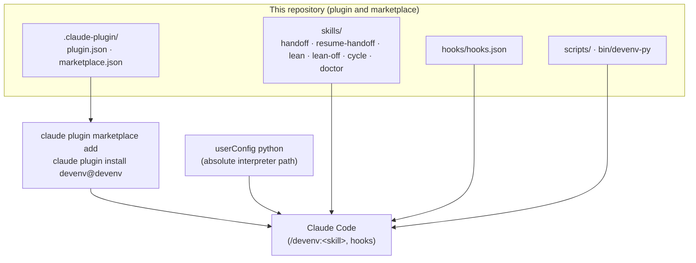
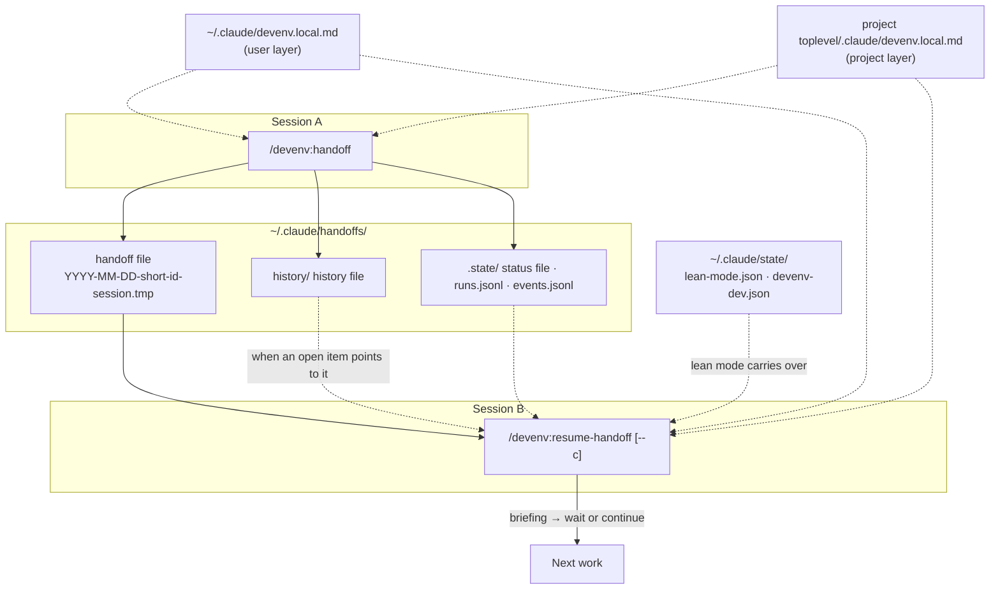
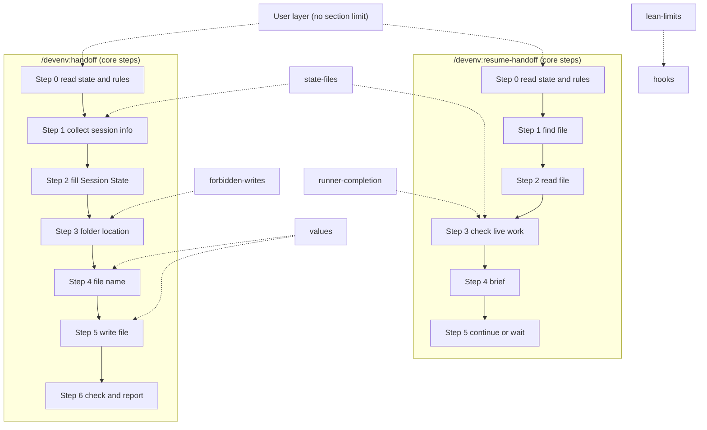

# devenv

English | [Korean](README.ko.md)

devenv is a Claude Code plugin that passes what one session knew to the next session and keeps the main session's context small with lean mode. This README owns the human-facing order of steps for devenv.

```sh
claude plugin marketplace add ai-dev-methodologies/devenv
claude plugin install devenv@devenv --scope user --config python=/path/to/python3
```

Replace `/path/to/python3` with the absolute path of a Python 3.10 or later interpreter. Then start a new session and run `/devenv:doctor`. The last line must show `fail=0`. Requirements and the other commands are in [Install](#install).

The README covers what devenv is, how to install it, how to use it, and how to check it. It owns seven facts:

- what devenv is, and its overall structure
- how to install, update, and remove it
- what each skill and hook does, and what the hooks do not stop
- the context carry-over principle and where the history file lives
- the rule layers (user layer and project layer)
- developer mode, the run log, and how to read the doctor output
- how to move from the older standalone handoff install

The format of the handoff file and the step-by-step procedures are owned by `skills/handoff/SKILL.md` and `skills/resume-handoff/SKILL.md`.

Contents: [What devenv Is](#what-devenv-is) · [Install](#install) · [Skills](#skills) · [What the Hooks Enforce](#what-the-hooks-enforce) · [Turning Lean Mode Off](#turning-lean-mode-off) · [Rule Layers](#rule-layers) · [Developer Mode and the Run Log](#developer-mode-and-the-run-log) · [Reading the Doctor Output](#reading-the-doctor-output) · [Moving from the Older Standalone Install](#moving-from-the-older-standalone-install) · [Limits](#limits) · [License](#license)

Release notes are in [CHANGELOG.md](CHANGELOG.md). The article [docs/article.md](docs/article.md) explains why devenv works this way.

## What devenv Is
devenv is a Claude Code plugin with six skills and five hook registrations. It passes what one session knew to the next session (`handoff` and `resume-handoff`), keeps the main session's context small with lean mode, which hooks enforce, runs a default plan-review-execute-verify cycle, and checks its own install (`doctor`). Every hook, and every script a skill calls, runs with the Python interpreter you name at install time.

### At a Glance
#### Install


#### Run (session A to session B)


Solid lines are the main flow of install, run, write, and resume. Dotted lines are references read when needed.

### Components
| Path | What it does |
|---|---|
| `.claude-plugin/plugin.json` | The plugin manifest: name `devenv`, version, license, and the required userConfig option `python` |
| `.claude-plugin/marketplace.json` | The marketplace `devenv` with one plugin at the repository root, so the install id is `devenv@devenv` |
| `skills/handoff/SKILL.md` | The `/devenv:handoff` skill. It sets the format of the handoff file and the steps to write it |
| `skills/resume-handoff/SKILL.md` | The `/devenv:resume-handoff` skill. It sets the steps to pick, read, and brief a handoff file |
| `skills/lean/SKILL.md` · `skills/lean-off/SKILL.md` | Turn lean mode on, read its state, and turn it off (the user types the off skill) |
| `skills/cycle/SKILL.md` | The default work cycle and its 14 override points |
| `skills/doctor/SKILL.md` | Runs `scripts/doctor.py`: install checks, developer mode, and the project rules file |
| `hooks/hooks.json` | Registers the five hooks with `${user_config.python}` as the command |
| `bin/devenv-py` | Runs a plugin script with the interpreter given after `--py`. Skills call scripts through it |
| `scripts/handoff_state.py` | Run once in Step 0 of both handoff skills. It prints the git state, the rules file paths, and the status file path; `--resume` also prints the chosen handoff, the `continue:` line, subagent states, and the check result |
| `scripts/check_handoff.py` | Checks that a handoff file follows the format. `/devenv:handoff` Step 6 and `handoff_state.py` call it |
| `scripts/run_log.py` · `scripts/run_report.py` | Write one line per handoff script run to `runs.jsonl` (developer mode), and summarize it read-only |
| `scripts/devenv_state.py` | The only writer of the lean mode and developer mode state files |
| `scripts/rules_layer.py` | Reads the rule layers and creates the project rules file |
| `scripts/hook_read.py` · `scripts/hook_bash.py` · `scripts/hook_return.py` · `scripts/hook_session_start.py` | The hooks (see "What the Hooks Enforce") |
| `scripts/events.py` | Records each hook decision to `events.jsonl` while developer mode is on |
| `scripts/context_budget.py` · `scripts/context_budget_check.py` | Measure the instruction files loaded at session start |
| `scripts/doctor.py` | Static checks, a replay of every registered hook, and live hook firing |
| `tests/` · `docs/field-map.md` | Tests that pin the behavior above, and a record of where each field of the old handoff format went |

### Files Created at Run Time
| Path | Written by | Contents |
|---|---|---|
| `~/.claude/handoffs/YYYY-MM-DD-<short-id>-session.tmp` | `/devenv:handoff` | One handoff body |
| `~/.claude/handoffs/history/<project folder>-<hash>.md` | `/devenv:handoff` (append only) | One line per item that has ended and that later steps do not use |
| `~/.claude/handoffs/.state/<top-level folder>-<hash>.status.txt` | `handoff_state.py` | The full list of changed files (the status file) |
| `~/.claude/handoffs/.state/runs.jsonl` | Both handoff scripts, developer mode only | Per run: output, exit code, and chosen file path (no body) |
| `~/.claude/handoffs/.state/events.jsonl` | The hooks, developer mode only | One line per hook decision, counts only |
| `~/.claude/state/lean-mode.json` · `~/.claude/state/devenv-dev.json` | `devenv_state.py` | Lean mode per project or session, and developer mode |
| `~/.claude/logs/context-budget.log` | The SessionStart hook, every session | One line with the start load of instruction files |
| `<plugin data>/bash-out/` | The Bash hook | Full outputs that were replaced, the newest 50 |

The hash of the status file is made from the top-level folder path. The hash of the history file is made from the `project key:` value, so linked worktrees share one history file. `<plugin data>` is the folder Claude Code gives the plugin as `${CLAUDE_PLUGIN_DATA}`.

## Install
Python 3.10 or later is required. Skills run scripts through `bin/devenv-py`, a POSIX shell script, so macOS and Linux are supported and Windows is not. The commands in this section were checked with Claude Code 2.1.321.

1. Add the marketplace: `claude plugin marketplace add ai-dev-methodologies/devenv`. The source may also be the URL `https://github.com/ai-dev-methodologies/devenv` or a local path. The marketplace is named `devenv`.
2. Install the plugin with the interpreter: `claude plugin install devenv@devenv --scope user --config python=/path/to/python3`.
3. Start a new session and run `/devenv:doctor`. The last line must show `fail=0`.

To set or change the interpreter later, `claude plugin configure devenv@devenv` shows the options and which are unset. To save a value, pass it on stdin:

```
echo '{"python": "/path/to/python3"}' | claude plugin configure devenv@devenv --values-stdin
```

Give a stable absolute path. An interpreter inside a virtual environment stops working when that environment is deleted or recreated, and then every hook ends in a non-blocking error. The doctor line `python-version` checks that the interpreter is 3.10 or later.

Skills call scripts as `devenv-py ${CLAUDE_PLUGIN_ROOT}/scripts/<script> … --py ${user_config.python}`. Each skill's `allowed-tools` lists exactly these calls.

devenv writes no run log line (`runs.jsonl`) while developer mode is off. To keep the run log going after moving from the older install, turn developer mode on after installing (`/devenv:doctor dev on`).

### After Installing
1. Run `/devenv:doctor` in a new session. Each line reads `DOCTOR <id> PASS|WARN|FAIL|SKIP <evidence>`, and the last line must show `fail=0`. What each line proves is in [Reading the Doctor Output](#reading-the-doctor-output).
2. Turn lean mode on where you want the hooks to act. `/devenv:lean` turns it on for this project, and `/devenv:lean session` for this session only. `/devenv:lean status` reports the state and turns nothing on. To turn it off, type `/devenv:lean-off`.
3. Run `/devenv:handoff` before you hand the session over or before the context fills. In the next session, run `/devenv:resume-handoff`. Add `--c` to keep working right after the briefing.
4. To use the short names `/handoff`, `/resume-handoff`, and `/lean`, add the link commands described in [Handoff and Resume](#handoff-and-resume).

### Update and Remove
| Command | What it does |
|---|---|
| `claude plugin marketplace update devenv` | Fetches the marketplace again from its source. Run it before `claude plugin update` |
| `claude plugin update devenv@devenv` | Updates the plugin. A restart is required to apply it |
| `claude plugin disable devenv@devenv` | Disables the plugin and keeps it installed |
| `claude plugin uninstall devenv@devenv --keep-data` | Uninstalls the plugin and keeps its data folder |
| `claude plugin marketplace remove devenv` | Removes the marketplace |

The state files under `~/.claude/state/` and the files under `~/.claude/handoffs/` are not removed by any of these commands.

## Skills
devenv has six skills. Each is called as `/devenv:<name>`.

| Skill | Who runs it | What it does |
|---|---|---|
| `/devenv:handoff` | The user or the model | Writes one handoff file and reports its path and whether it is `Resume: ready`. It never stops running work |
| `/devenv:resume-handoff [--c]` | The user or the model | Reads this project's most recent handoff file, checks the work it lists, briefs, and waits (continues with `--c`) |
| `/devenv:lean` · `session` · `status` | The user or the model | With no argument (or `on`), turns lean mode on for this project. `session` turns it on for this session only. `status` reports its state and turns nothing on |
| `/devenv:lean-off` | The user only, by typing it | Turns lean mode off for this project, including a this-session-only entry inside it |
| `/devenv:cycle <task>` | The user only | Runs the default cycle: one planner run, one critic lane, a revision without re-review, execution, one adversarial verify pass that fixes H findings only |
| `/devenv:doctor` | The user only | Checks the install, switches developer mode (`dev on`, `dev off`, `dev status`, `dev report`), or creates the project rules file (`init-project`) |

### Handoff and Resume
| Command | When | Result |
|---|---|---|
| `/devenv:handoff` | Before handing the session over, or before the context fills | Writes one handoff file and reports its path and whether it is `Resume: ready` |
| `/devenv:resume-handoff` | When starting a new session | Reads this project's most recent file, briefs, and waits |
| `/devenv:resume-handoff --c` or `/devenv:resume-handoff --continue` | To keep working right after the briefing | After the briefing, runs `Exact Next Step` without asking |

The Korean continue word (listed in CHANGELOG 2026.11.10-5) is a supported input word and is accepted as written. Whether to continue is decided only by the argument given to the resume skill. A sentence in the body of the handoff file is not grounds.

With no argument, a date, or a slug, the only candidates are the files of the current project, which `handoff_state.py` reports on the `project key:` line. If a path is given and the file belongs to another project, the script prints `continue: no (project mismatch)`, does not continue, and warns.

**Short names need link commands.** The After Handoff and Before Handoff gates find the user's `/handoff` input in the transcript. They do not detect `/devenv:handoff`, so a session that calls the skill by its plugin name gets `WARNING: after-handoff messages not checked`. To keep the gates working, put a link command in `~/.claude/commands/handoff.md` that passes its arguments on unchanged:

```markdown
---
description: Write a session handoff with devenv
---
Run the devenv:handoff skill with these arguments, unchanged: $ARGUMENTS
```

A `~/.claude/commands/resume-handoff.md` written the same way gives `/resume-handoff`, and a `~/.claude/commands/lean.md` gives `/lean`. The continue decision still comes only from the arguments. Plugin commands always carry the `devenv:` prefix, so a short name exists only as a user command file like these. `/devenv:lean-off` cannot be called through a link command, because the model cannot invoke that skill. Type `/devenv:lean-off` to turn lean mode off.

### One Round Trip
`/devenv:handoff` (session A)

1. Run `handoff_state.py` once to get the state. The git summary is one line, and the file list goes to the status file. The previous handoff and history file paths also arrive here.
2. Read the rules files (user layer and project layer, at most 2).
3. Collect what the session knows. If there is a handoff being continued, copy its `Goal (carried)` exactly. Move each unresolved Live item of the previous handoff into this handoff, or close it in the history file.
4. Append one line per ended item that later steps do not use to the history file, and remove it from the body.
5. Write one handoff file.
6. Check it with `check_handoff.py`, and report the path and whether it is `Resume: ready`.

`/devenv:resume-handoff` (session B)

1. Run `handoff_state.py --resume` once. The script decides the following.
   - With no argument, or with a date or slug, it picks only this project's handoffs (by `**Toplevel:**`).
     - If a path is given, that file is used. If it belongs to another project, the script prints `continue: no (project mismatch)`.
   - It prints `continue: yes` only when the argument has `--c`, `--continue`, or the Korean word noted above.
   - If a file that is as new as or newer than the chosen one is dropped, it prints `WARNING: newer handoff skipped (<reason>): <file name>` and `continue: no (newer handoff skipped)`. Work does not continue even with `--c`. The reason is `no usable Exact Next Step`, `empty file`, `project unknown`, or `not valid UTF-8`. A file confirmed to belong to another project is not listed, and a path argument is not affected.
   - For each subagent it prints `live subagent: … -> returned / running? / lost / unknown`, at most 5 lines.
2. Read the rules files (0 to 2), then read the whole handoff file.
3. Check the state of running work, read-only.
   - Subagents: decided from `ListAgents` and the `live subagent:` lines.
   - Runners: one read-only agent decides from `done-when`.
   - Scheduled jobs: not judged. The briefing lists them with `fires-at`.
4. Brief. The first item after the header line is the original goal (`Goal (carried)`).
5. If `continue: yes`, keep working without asking. Otherwise, wait after the briefing.
   - Order when continuing: `after-return` of `returned` items, then re-dispatch of `lost` items, then `Exact Next Step`.

### Structure of a Handoff File
| Part | Contents | When continuing |
|---|---|---|
| Header lines | `**Project:**` · `**Toplevel:**` (identifies the project) · `**Continues:**` · `**Session:**` · `**Topic:**` | `Continues` holds the path of the file being continued. `none` for the first one. `Session` holds this session's id, or `none` |
| `## Confidence` | `high` · `medium` · `low` | Decided anew each time |
| `## Session State` | Branch · HEAD · changed files · three Live fields (`Live subagents` · `Live runners` · `Live scheduled`) | Move each unresolved Live item, or close it in the history file |
| `## Goal (carried)` | `Origin` · `Goal` · `Done-when` · `Constraints` · `Changes` | Copy as is. Change it only when the user says to. Only adding new items to the end of `Constraints`, separated by `; `, is free. Existing items stay as they are. `none` means zero items |
| Work record sections | What we are building · what worked · what did not work · discarded hypotheses · what has not been tried · state of files · decisions (`What` · `Why` · `How` table) · blockers | Move what has ended and what later steps do not use to the history file. Keep what did not work and the discarded hypotheses |
| `## Closed (pointers)` | The history file path and the keys of the closed items | Only when there are closed items |
| `## Reviews` | One row per review run of the session (optional, right after the decisions) | Not carried over. Keep the conclusions in the decisions |
| `## Exact Next Step` | What the next session does first | Written anew each time |
| `## Before Handoff` | One line per user message right before `/handoff` and per argument of it (optional, right before `## After Handoff`) | Read in the briefing. Not rewritten into the body |
| `## After Handoff` | One line per user message after `/handoff` started (optional, always last) | Read first in the briefing. Not rewritten into the body |

In the `Why` cell of the decisions table and the why line of an open item, the user's words are quoted as they were said. A reason that is the agent's own judgment starts with `agent:`.

### Context Carry-over
The original goal and purpose, and the context still in progress, are kept across the whole chain. Context that is finished or no longer needed is not carried. Context that is not carried is recorded in the history file and then forgotten.

| Item | Handling | Where |
|---|---|---|
| The original goal and done-when condition | The handoff that continues copies them as they are. It does not summarize them again | The `## Goal (carried)` section of the handoff |
| A change to the goal or done-when condition | Change it only when the user says to. Keep the date and the quote | `Changes` in `Goal (carried)`, and `Requirement Changes` |
| What was decided not to do, and what is out of scope | The handoff that continues copies them as they are. New items may be added at the end, separated by `; `. Existing items stay as they are. To delete or edit, leave a `Changes` item with the user quote and `Constraints:` | `Constraints` in `Goal (carried)` |
| The previous handoff | Write the path of the file this session continued | Header line `**Continues:**` |
| An item that has ended and that later steps do not use | Remove it from the body and append one line to the history file | The history file, and `## Closed (pointers)` of the handoff |
| Failed methods and discarded hypotheses | Do not move them to the history file. Keep them in the body to prevent retries | `What Did NOT Work`, `Discarded Hypotheses` |

#### History File
- The path is `~/.claude/handoffs/history/<folder name>-<first 8 characters of the project key hash>.md`. `handoff_state.py` reports it on a `history file: <path> (exists)` or `history file: <path> (new)` line. With `(new)` the file does not exist yet, so create it. With `(exists)`, append to it.
- The line format is `<date> · <key> · <what ended> · <result or evidence path>`.
- The handoff skill only appends lines to the history file. It does not delete or edit existing lines.
- The resume skill does not read the history file by default. It reads it only when the `how` of an open item points to a history key.
- A handoff points to the history file with one line in the `## Closed (pointers)` section.

#### After Handoff
A decision the user gives after `/handoff` starts is not in the file body. Two gates keep it from being lost.

- The handoff file has a header line `**Session:** <id>` (the `session id:` line that `handoff_state.py` prints in Step 0, or `none`) and an optional last section `## After Handoff`. Each user message after `/handoff` starts, whether typed, queued, or a dialog answer, gets one line there: `- 「<user message verbatim>」 → decision: <what changed and how>`. `→ decision: unchanged` is also a line. The body is not rewritten, and this section wins where it differs from the body.
- Writing gate: when `CLAUDE_CODE_SESSION_ID` is a UUID, `check_handoff.py` reads this session's transcript. It exits 1 with `after-handoff` when a user message after the last `/handoff` is not quoted in the section, and prints the missing messages verbatim (at most 5). It exits 1 with `contract-session` when `**Session:**` is missing or is not this session's id. To check an older file by hand from another session, run the checker with `env -u CLAUDE_CODE_SESSION_ID` in front.
- Resume gate: when the file's `**Session:**` is a UUID, `handoff_state.py --resume` reads that transcript again. Messages that the section does not quote make `continue: no (unrecorded messages after handoff)`, even with `--c`, and print `WARNING: N user message(s) after the last /handoff are not in the handoff file`. The briefing starts with an `AFTER HANDOFF:` block.
- Degrade: when the transcript is missing, unreadable, too large, or in an unknown format, or has no `/handoff` input, both gates print `WARNING: after-handoff messages not checked: <reason>`. Exit codes and `continue:` do not change.
- With the session variable, `handoff_state.py` in its default mode prints two more lines, `session id: <uuid>` and `transcript: <path | none (not found)>`.
- Accepted limit: the gates compare user messages only. A decision that was reached but never typed is not caught.

#### Before Handoff and Reviews
Two more optional sections keep what the session knew right before `/handoff`.

- `## Before Handoff` (right before `## After Handoff`): one line per user message right before the last `/handoff` input (the last 5) and per argument of that input. A line is `- 「<the user's own sentence>」 → reflected: <section title>` or `- 「…」 → unrelated`. `reflected:` names a `## ` section of the file exactly.
- `## Reviews` (right after `## Decisions Made`): one row per review run of the session: `- <agent id | runId> · <type> · <final verdict | running> · <adopted or rejected, one line>`. A review run is an Agent whose type, after its last `:`, contains `review`, `critic`, or `judge` or equals `architect` or `verifier`, and every Workflow run.
- Writing gate: when `CLAUDE_CODE_SESSION_ID` is a UUID, `check_handoff.py` exits 1 with `before-handoff` or `reviews` for each missing line or row. It exits 1 with `contract-next-step-deps` when a numbered `Exact Next Step` step after a 🔴 user step lacks `(independent)` or `(← n)`. When the transcript cannot be read, `WARNING: reviews not checked: <reason>` is printed and the exit code does not change.
- Legacy Korean markers from before 2026.11.10-5 are still accepted; CHANGELOG lists them.
- Resume: `handoff_state.py --resume` prints `before handoff: N user message(s)` with the messages (at most 6). It is display only, so `continue:` does not change. The briefing has a `BEFORE HANDOFF:` block and a `REVIEWS:` block.
- Size: the checker warns above 24 KiB (`WARNING: handoff file is <N> KiB (over 24 KiB)`).

### Exit Codes
These are the exit codes of `handoff_state.py`.

| Code | Meaning |
|---|---|
| 0 | Success |
| 1 | `--resume` found no handoff for this project |
| 2 | Usage error |
| 3 | The checker is missing or ended abnormally |
| 4 | Internal error (an unexpected exception). The last 5 lines of the traceback go to stderr |

These are the exit codes of `check_handoff.py`.

| Code | Meaning |
|---|---|
| 0 | Pass |
| 1 | Check failed. The list of problems is printed |
| 2 | Usage error, file missing or unreadable, or an unexpected error |

## What the Hooks Enforce
The hooks act only in a project or session where lean mode is on. Turn it on with `/devenv:lean` (this project and every folder inside it, in every session) or `/devenv:lean session` (this session only). `/devenv:lean status` reports the state without turning it on. A session opened in a folder above that project, such as a home folder or an outer repository, is not enforced.

| Hook | Event | While lean mode is on |
|---|---|---|
| `hook_read.py` | PreToolUse (Read, Write, Edit, Bash) | Refuses a Read of a text file over 32 KiB or 400 lines unless it asks for a line range within the limit. Refuses a Write or Edit of the lean state file and a Bash command that runs the state tool's `lean off` (see "What the Hooks Do Not Stop") |
| `hook_bash.py` | PostToolUse (Bash) | Replaces output over 16 KiB or 200 lines with its first 40 lines and the path of a file holding the full output |
| `hook_return.py` | SubagentStop, PreToolUse (SubagentHandback) | Sends a subagent reply over 30 lines back once to be shortened |
| `hook_session_start.py` | SessionStart | Reminds the session that lean mode is on, and reports the start load when it is over 48 KiB |

- The Read and Bash hooks act on the main thread only. A subagent can still read what its task needs.
- Binary files and files under `~/.claude/handoffs/` are not refused.
- The limits come from the `## lean-limits` section of the rule layers (see "Rule Layers").
- A lean state file that cannot be read is `unknown`, not off. The call goes ahead with a visible warning.
- On bad input or an internal error a hook exits 1, which Claude Code shows as a non-blocking hook error.

### What the Hooks Do Not Stop
- **Large output of tools whose output format is not documented** is not stopped. An agent listing is one example.
- A shell command that changes the lean state file directly is not refused: a redirection, deleting (`rm`), moving (`mv`), or changing permissions (`chmod`). A state file made unreadable this way is `unknown`, and enforcement stops with a warning.
- A run through one more shell or interpreter that builds the off command or the file change at run time is not refused.
- The length of the main session's own reports is a convention in the lean skill, not a hook.
- When the interpreter is missing, every hook ends in a non-blocking error and the tool call goes ahead. The doctor replay finds this.

## Turning Lean Mode Off
The user turns lean mode off by typing `/devenv:lean-off`. The model cannot invoke that skill, and the Read hook refuses a Write or Edit of the state file and the state tool's `lean off` command, in subagents too. `/devenv:lean off` answers with one line and changes nothing.

When a folder above this project still has lean mode on, the off skill keeps it on there and records this project as off.

The off skill removes this project's own entry and the this-session-only entries set in this project. A project inside it with its own entry, such as a nested repository, keeps lean mode on.

## Rule Layers
The engine defaults are the same for every user. What a user or a project wants to do differently goes into the two rules files. The layers apply in this order:

1. Engine defaults (`scripts/rules_layer.py` and the skill documents)
2. User layer
3. Project layer

A later layer wins over an earlier layer. What a later layer does not write follows the earlier layer. The files are read when a command runs, so they add nothing to the start load.

| Layer | File | Scope |
|---|---|---|
| Engine defaults | `scripts/rules_layer.py`, the skill documents | All users and projects |
| User layer | `~/.claude/devenv.local.md` (else the older `~/.claude/handoff-rules.local.md`) | All projects of this user. No section limit |
| Project layer | `<toplevel>/.claude/devenv.local.md` (else the older `.claude/handoff-rules.local.md`) | That project. Uses only the listed override points |

`handoff_state.py` reports the paths of the two rules files on two lines, `user rules file:` and `rules file:`. When both names exist in one layer, `WARNING: both .claude/devenv.local.md and .claude/handoff-rules.local.md exist; using devenv.local.md` is printed. A file with the older name keeps the four handoff points only. When both files exist, only `devenv.local.md` is read, so move what the older file holds into it and remove the older file.



### What Each Rules File Holds
- The user layer holds one person's own working rules. Example: how work is split and handed off, and which tools are used.
- The project layer holds facts that are true only for that project. Example: the marker that tells that the project's runner has finished, and design files to read separately.

### Which Points the Project Layer Overrides
The project layer overrides only the points below, each with a `## <identifier>` section heading. A `:` and a description may follow the identifier. Example: `## runner-completion: how to judge runner completion`.

| Identifier | What it overrides | Where it applies |
|---|---|---|
| `runner-completion` | How to judge that a running runner has finished | `/devenv:resume-handoff` Step 3 |
| `state-files` | Extra state files and design file paths to read | `/devenv:handoff` Step 1 · `/devenv:resume-handoff` Step 3 |
| `forbidden-writes` | Paths that must not be written | `/devenv:handoff` Step 3 |
| `values` | Item-level names · session file size limit · short-id format | `/devenv:handoff` Step 4 · Step 5 |
| `lean-limits` | `key: number` lines: `read_bytes`, `read_lines`, `bash_bytes`, `bash_lines`, `bash_head_lines`, `return_lines` | The hooks |
| `doctor-settings` | Names of settings keys the doctor looks for (user layer) | `/devenv:doctor` line `settings-names` |
| The 14 cycle points | `plan-lane`, `critic-lanes`, `review-rounds`, `grading`, and the others listed in `skills/cycle/SKILL.md` | `/devenv:cycle` |

- A `lean-limits` value can raise a limit to at most 4 times its default. Example: 1600 for `read_lines`, 120 for `return_lines`.
- A larger value is cut to that cap with a warning. `/devenv:doctor` reports it as WARN on the `rules-limits` line.
- Why the cap exists: the model can write the rules files while lean mode is on. Without a bound, one large value would turn the limits off.

Write a `doctor-settings` section in this format:

- One settings key name per list line, its parts joined by dots, with no file name in front. Example: `- enabledPlugins.devenv@devenv`.
- The doctor looks each name up in `settings.json` and `settings.local.json` together. It also finds a key that holds a dot itself. Example: `extraKnownMarketplaces.my.market`.
- A list line in another format is skipped, and the `settings-names` line warns with the number of such lines.

If there is a `## ` section outside the list, `WARNING: rules file section outside override points: <heading>` is printed. That section is not applied. The warning does not change the exit code.

### Keeping the Project File Out of Git
The project rules file records how one person runs work in that repository, not facts about the code. Keep it out of git: put `.claude/devenv.local.md` in `.gitignore`. `/devenv:doctor init-project` creates the file with every point as a sample heading and prints the `.gitignore` line when git does not ignore the file yet. The doctor line `rules-ignored` warns while the file is not ignored.

### What Must Not Be Written
- **Restating the engine rules.** Do not write again what the skill documents already set. When the engine changes, the two places drift apart.
- **History and dates.** Leave when and why something changed in the commit message.
- **Sensitive values.** Do not write the value of a token, password, or environment variable. Write only the name.
- **Sections outside the list (project layer).** A section that is not one of the listed identifiers is not applied.

## Developer Mode and the Run Log
Developer mode is off by default. While it is off, devenv writes no run log line to the default path and no event line. Turn it on with `/devenv:doctor dev on`, off with `/devenv:doctor dev off`, and read it with `/devenv:doctor dev status`. The state is kept in `~/.claude/state/devenv-dev.json`.

- Each run of the two handoff scripts appends one JSON line to `~/.claude/handoffs/.state/runs.jsonl`. It records the path of the handoff file, not the body. When the file exceeds 5 MB, it is renamed to `runs.jsonl.1` and a new file starts.
- `HANDOFF_LOG` names another run log path and is written whether developer mode is on or off. `HANDOFF_LOG=off` writes nothing.
- Each hook decision appends one line to `~/.claude/handoffs/.state/events.jsonl` with the version, the kind (`read_deny`, `bash_replace`, `return_block`, `handback_deny`, `return_pass`, `session_start`), and integer counts only.
- The SessionStart hook appends one start load line to `~/.claude/logs/context-budget.log` in every session, whatever the mode.

### Run Log Keys
Every line has 26 keys. These twelve are the newest. A key without a value is `null`. Lines written by an older version lack them, and the report counts those lines under Coverage.

| Key | Contents |
|---|---|
| `session_id` | The value of `CLAUDE_CODE_SESSION_ID` when it is a UUID (8-4-4-4-12 hex digits); otherwise `null` |
| `caller` | `handoff_state.py` when that script ran the checker, set through `HANDOFF_CALLER`. Otherwise `null` |
| `project` | The project key. For a check run, the `**Toplevel:**` of the checked file when it is an existing absolute folder |
| `fail_codes` | `check_handoff.py` only. An object of fixed failure codes with counts, `{}` on a pass, `null` for `handoff_state.py` |
| `handoff_bytes` | `check_handoff.py` only. The UTF-8 byte count of the checked text after newline normalization to LF |
| `after_handoff_lines` | `check_handoff.py` on the writing side only. The number of user messages after the last `/handoff`. `null` when the gate did not run |
| `before_handoff_lines` | The same side. The number of Before Handoff messages (the arguments of `/handoff` included, 0 to 6) |
| `before_unrelated` | The same side. How many matched Before Handoff lines end in `unrelated` (or its legacy marker) |
| `attempt_n` | The same side. The try number at this handoff file in this session |
| `elapsed_ms` | The same side. Milliseconds from the last `/handoff` input to this check |
| `reviews_found` | The same side. The number of review runs found in the transcript. `null` when it could not be judged |
| `reviews_recorded` | The same side. How many of them have a valid row in `## Reviews` |

### Run Report
`/devenv:doctor dev report` prints the event counts per version and kind, and the run report. The run report comes from `run_report.py`, which reads the run log (and `runs.jsonl.1` when it exists) and prints what happened and what to fix. It never writes the log, and it never prints the `stdout` or `args` of a record. Do not paste report output into a public repository, because it holds local paths and session ids.

To run the report with options, call the script with the configured interpreter. `<plugin root>` is the folder Claude Code gives the plugin as `${CLAUDE_PLUGIN_ROOT}`.

```
<python> <plugin root>/scripts/run_report.py [--log PATH] [--since DATE] [--project PATH] [--version V] [--json]
```

| Option | Meaning |
|---|---|
| `--log PATH` | The log to read. The default is the run log path, and `HANDOFF_LOG` is respected |
| `--since DATE` | Only records at or after the date. Form: `YYYY-MM-DD` or `YYYY-MM-DDTHH:MM:SSZ` |
| `--project PATH` | Only records of that project |
| `--version V` | Only records of that version. `V` also matches `V-<n>` and `V.<n>` |
| `--json` | The same content as JSON with fixed keys |

- A run that only printed the usage is counted as `handoff_state.py/usage` or `check_handoff.py/usage` in Runs.
- Check failures also gives the attempts to pass per version (`attempts_by_version`, one line per version).
- Handoff size counts the last direct check of each file directly under `~/.claude/handoffs/`. The limit is 24 KiB (`over_24_kib`).
- Exit code 0: the report was printed, including when the log is missing or empty. Exit code 2: a usage error, a log path that cannot be read, or an internal error.

### Environment Variables
| Name | Meaning |
|---|---|
| `HANDOFF_LOG` | The path of the run log file. If the value is `off`, nothing is logged |
| `HANDOFF_CHECKER` | The path of the checker that `handoff_state.py` calls. If unset, it uses `check_handoff.py` in the same folder |
| `CLAUDE_CODE_SESSION_ID` | Set by Claude Code. The run log records it as `session_id` when it is a UUID, otherwise `null`. No other variable is recorded |
| `HANDOFF_CALLER` | Set by `handoff_state.py` for the checker it runs. The run log records it as `caller` only when the value is `handoff_state.py` |

`handoff_state.py` runs `context_budget.py` from its own folder (else an older copy in `~/.claude/scripts/`) and prints a `context-budget:` line. It prints one `lean-mode:` line (`on (since <UTC time>)`, `off`, `off (set for another project)`, or `unknown`) so that a resumed session knows lean mode carries over.

## Reading the Doctor Output
`/devenv:doctor` prints one `DOCTOR <id> PASS|WARN|FAIL|SKIP <evidence>` line per check and ends with `DOCTOR summary pass=N warn=N fail=N skip=N`. PASS lines are folded into the summary; `/devenv:doctor verbose` prints them too. The doctor never changes a file, and FAIL marks only what a machine checked.

```
DOCTOR plugin-version PASS CHANGELOG.md=<version> plugin.json=<version> run_log.VERSION=<version>
DOCTOR replay-bash PASS replace large output, pass small output, pass large output with lean off, record bash_replace (proves: script, interpreter, registered command line)
DOCTOR live-bash SKIP (no live firing recorded) bash_replace in version <version>; developer mode off; …
DOCTOR summary pass=17 warn=0 fail=0 skip=8
```

| Lines | What a PASS proves | What it does not prove |
|---|---|---|
| Static (`python-version`, `plugin-version`, `hook-scripts`, `skill-description`, `lean-state`, `dev-state`, `rules-*`, `paths`, `settings-names`, `legacy-*`, `start-load`, `hook-errors`) | The files and values on this machine, as the doctor read them | Anything about a running session |
| `replay-*` | The registered command line, the interpreter, and the script deny, replace, or pass the test inputs as they should, in a temporary folder | That Claude Code calls the hook |
| `live-*` | Claude Code really fired that hook in this version, as recorded while developer mode was on | That a Bash replacement had the right shape (only the harness debug file records a wrong shape) |

`replay` and `live` answer different questions. A `replay` line runs each registered hook command with violating, clean, and lean-off inputs and with temporary state, so it never touches the real state files. A `live` line reads `events.jsonl`. It is `SKIP (no live firing recorded)` until developer mode is on and the hook has fired in the current version.

Exit 0 means no FAIL and no replay SKIP. Exit 1 means a FAIL or a replay SKIP. Exit 2 means the doctor itself failed. A live SKIP does not change the exit code. Evidence names keys, paths, and counts, never a settings value.

## Moving from the Older Standalone Install
The older standalone handoff install placed two command files in `~/.claude/commands/` and four scripts in `~/.claude/scripts/` (`handoff_state.py`, `check_handoff.py`, `run_log.py`, `run_report.py`). Both can stay installed while you move.

Do not keep using the older lean skill or the older scripts alongside the plugin. The older lean skill rewrites the whole state file, so the lean entries of other projects are lost. Clean up in this order:

- Stop using the older lean skill from step 2 on.
- Back up and remove the older files in step 5.
- Confirm with step 6.

1. Before installing, note the running Claude Code processes (`pgrep -fl claude`) and the free disk space.
2. Install the plugin (see "Install") and run `/devenv:doctor` in a new session. `legacy-install` and `legacy-budget-hook` warn while the older files are present.
3. Run `/devenv:doctor dev on`, then `/devenv:handoff` once. The last line of `runs.jsonl` carries the plugin version, which tells it apart from the older command.
4. Turn lean mode on in a test project and check one refused Read, one replaced Bash output, and one returned subagent reply. Then `/devenv:doctor` shows `live` PASS lines. Type `/devenv:lean-off` to end the test.
5. Back up, then remove the older files: copy the four scripts, any lean skill you installed under `~/.claude/skills/`, and `~/.claude/settings.json` to a backup folder such as `~/devenv-migration-backup/<date>/`. Then remove the four scripts, that lean skill, and a SessionStart entry that runs `context_budget.py`. Replace the two command files with the link commands (see "Handoff and Resume").
6. Run `/devenv:doctor` again. `legacy-install` and `legacy-budget-hook` must pass.

### Roll Back
1. Run `claude plugin disable devenv@devenv`, or `claude plugin uninstall devenv@devenv --keep-data`.
2. Run `claude plugin marketplace remove devenv`.
3. If step 5 was done, restore the files from the backup folder to the same paths under `~/.claude/`.

## Limits
- devenv installs no rules files, `CLAUDE.md`, settings, or agent definitions. It ships skills, hooks, and scripts only. Your own working rules stay in your files (see "Rule Layers").
- Large output of tools whose output format is not documented (an agent listing, for example) is not stopped.
- A shell command that changes the lean state file directly is not refused: a redirection, `rm`, `mv`, `chmod`, or a run through one more shell or interpreter that builds the command at run time.
- A Bash command that names the state tool together with the words `lean` and `off` is refused while lean mode is on, even when it would change nothing (a `grep` of the state tool, for example).
- When the working folder moves to another project during a session, the lean judgment follows that folder.
- In auto mode the return gate refuses a long report once per agent.
- Up to 32 this-session-only entries are kept. The oldest is dropped first.
- The length of the main session's own reports stays a convention.
- `/devenv:handoff` called by its plugin name is not seen by the After Handoff and Before Handoff gates. Use the link commands.
- An `allowed-tools` match may fail when the plugin path holds a space.
- Whether a skill's script line opens an approval prompt in an interactive session has not been checked. Headless runs were checked.
- Windows is not supported, because `bin/devenv-py` is a POSIX shell script.
- How much context the enforcement saves has not been measured. Developer mode records how many times enforcement acted, not what it saved.
- The release test checks that the top `CHANGELOG.md` version, the `plugin.json` version, and `run_log.VERSION` are equal. It does not catch a release whose content changed while its version did not.

## License
MIT. See [LICENSE](LICENSE).
